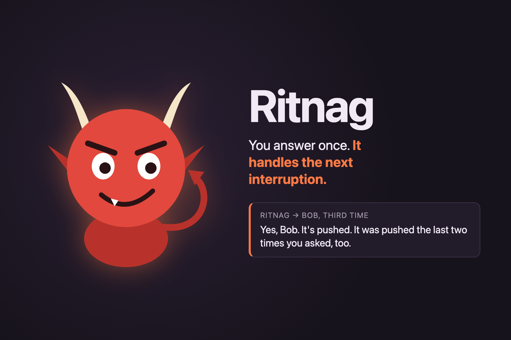

# Ritnag

> You answer once. Ritnag handles the next interruption, with your memory and its own attitude.



Ritnag is a mischievous desktop companion built at Cal Hacks 13.0. It listens while you work, remembers what you
answer, recognizes when someone asks the same thing again (even reworded), and answers aloud in the tone you picked
for that person. When something needs you, it gets you.

## What it does

- **Learns from the owner, and only the owner.** Answer a question or announce a decision once ("make sure to CC
  me on the emails") and it becomes a memory, with where you said it.
- **Answers repeats.** "Who was I supposed to CC?" matches that memory and gets answered aloud, with a receipt on
  screen: which memory, how many times this person has asked.
- **Knows who's talking.** Your voice is enrolled once. When it hears a voice it doesn't know, it asks you
  "who was that?"; your answer ("that was Preston, he's annoying") names that person, sets how to treat them, and
  learns their voice, so it recognizes them in later sessions.
- **Talks to each person your way.** Friendly, playful, sarcastic, annoyed, savage or flirty, plus your own note
  ("talk to him like he's five"). Roasts target behavior, never identity.
- **Knows what it can't do.** It never invents an answer. Approval, deploy and payment requests always come to
  you as an alert, with a chime and a system notification.
- **Focus mode.** It handles questions even right after you spoke, and relays the ones only you can answer
  ("Leon, Jason needs to know where your keys are"); your reply is learned and clears the alert. Outside focus
  mode it stays quiet while you're in a conversation.
- **Reports back.** "Give me a report on the day" gets a short spoken recap of who asked what.

## How it works

```
mic ─► Speechmatics (speech-to-text, who's speaking) ─► turn assembly + owner check
    ─► Moss (find the matching memory) ─► Claude (decide: answer · learn · name someone · alert · stay quiet)
    ─► executor (permission + citation checks) ─► Cartesia (the imp's voice, streamed)
```

- **Moss** indexes every memory for semantic search; **local JSON** (`data/imp-memory.json`) is the source of truth.
- **Claude** (Haiku) judges whether a retrieved memory really answers the question and writes the line;
  `server/executor.ts` enforces that answers cite real, active memories and that only the verified owner can teach.
- **Cartesia** speaks every line, with delivery matched to the person's tone, plus instant reaction clips.
- **Speechmatics** transcribes and identifies the enrolled owner and recognized visitors; Deepgram is a fallback.
  A local sherpa-onnx speaker model double-checks the owner.

Details: [docs/ARCHITECTURE.md](docs/ARCHITECTURE.md) · [docs/SPEAKER_ID.md](docs/SPEAKER_ID.md)

## Run it

Requires Node 22+ and API keys for Anthropic, Cartesia, Moss and Speechmatics (or Deepgram).

```bash
npm install
cp .env.example .env    # fill in the keys; set OWNER_NAME to your name
npm run dev
```

Open the `http://localhost:3000/#token=…` link the server prints (the token is saved in your browser after the
first visit). Enroll your voice from the top bar (about 90 s), press **Start listening**, and talk.

Data stays in `data/` (gitignored): memories and people, the browser access token, your voice profile (an
embedding only, deletable from Settings) and the cached speaker model. Provider keys never reach the browser.

| Command | |
| --- | --- |
| `npm run dev` | UI + API on one origin, restarts on save |
| `npm run demo` | Demo day: separate demo records, opens in Demo Mode, no auto-restart ([guide](docs/DEMO_DAY.md)) |
| `npm run check` | Typecheck + tests + build |
| `npm run build && npm start` | Production build served by Node |
| `npm run voice:model` | Prefetch the speaker-verification model (~26 MB) |
| `npm run smoke:voice` | Two synthetic spoken questions through the whole pipeline, with timings |
| `npm run director -- …` | Scripted playback of the UI for recordings (see below) |

## Demo video and director mode

`docs/DIRECTOR.md` describes a director mode that plays a timed script on the UI: transcript lines, pop-ups,
memory cards, the imp's captions. We used it to produce the screen recording in our demo video so it lines up
exactly with the filmed scene (`docs/director/demo-1024.json`). **The on-screen UI in the video is that scripted
re-enactment, not a capture of the live run.** Every behavior it shows is implemented and runs live, and
`docs/PROGRESS.md` records what was verified and how; we're happy to demo it live.

## Docs

- [Architecture](docs/ARCHITECTURE.md) · [Speaker identification](docs/SPEAKER_ID.md) · [Progress and verification](docs/PROGRESS.md)
- [Demo day operator guide](docs/DEMO_DAY.md) · [Demo script](docs/DEMO.md) · [Rehearsal runbook](docs/REHEARSAL.md) · [Director mode](docs/DIRECTOR.md)
- [Build plan](docs/BUILD_PLAN.md) · [Cal Hacks notes](docs/CALHACKS.md) · [Devpost draft](docs/DEVPOST.md)

## Team

Built at Cal Hacks 13.0 (Oct 24–25, 2026) by Preston Brown, Leon Khoshnevis and Ritvik Sharma.
