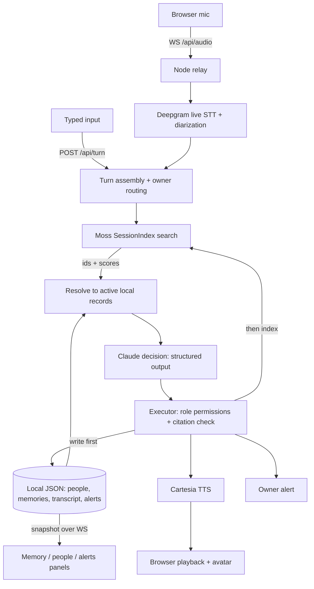

# Architecture

Current as of 2026-10-24 (Moss + Cartesia revision).

## Responsibilities

| Component | Owns | Does not own |
| --- | --- | --- |
| Deepgram | Transcription, per-connection speaker labels | Persistent identity |
| Session (`server/session.ts`) | Speaker-label → person bindings for the current connection, single-flight decision queue, generation guard, half-duplex mic gate | Persistence |
| Local JSON (`server/memory.ts`) | **Source of truth**: people, tone, priority, transcripts, memories, question events, alerts | Search |
| Moss (`server/providers/moss.ts`) | Semantic + keyword retrieval over memories. Doc id = local memory id | Truth, freshness, speaker ID |
| Claude (`server/providers/claude.ts`, `server/decision.ts`) | Judging whether retrieved memories actually answer the question, importance, learning extraction, person-specific wording | Executing anything |
| Executor (`server/executor.ts`) | What is allowed: guests can't teach or rename; answers must cite retrieved, active memory ids; approvals always escalate | Wording |
| Cartesia (`server/providers/cartesia.ts`) | Voice | — |

## Visitor turn

1. Turn is finalized and deduplicated by `(connectionId, providerEventId)`.
2. `index.search(turn.text, topK=8)` against Moss.
3. Hits are resolved against `listActiveMemories()`. Superseded, expired, or deleted ids are dropped, so a stale index can't bring an old fact back.
4. Claude receives the resolved memories with scores, the recent transcript, the speaker's tone and priority, and focus mode. The prompt states that a match isn't proof and asks Claude to check subject, freshness, and support.
5. The executor accepts `ANSWER` only if every cited id is in the retrieved set. An unsupported important answer becomes an alert, and an unsupported ordinary one becomes `WAIT`.
6. Spoken text gets a response id that is tied to the session generation. `/api/speech` refuses stale ids both before and after synthesis.

## Owner turn

- `LEARN` writes the memory locally first, then upserts it into Moss. A superseded memory is removed from the index.
- `UPDATE_PERSON` binds the single pending unknown visitor's label. If there are several, the imp asks "Which one?" and the UI selector resolves it.

## Moss index lifecycle

- On boot and on **Rebuild index**, a fresh `SessionIndex` is filled from all active local memories. The cloud index is then replaced via `pushIndex()`, debounced 3 s after any change.
- Session queries and upserts run in-process. A just-taught answer is searchable immediately, before the cloud push.
- Failures set `index.lastError`. The UI shows a banner, and every decision records `retrieval.mode` ("moss" or "unavailable"). When unavailable, Claude gets up to 50 recent active memories and is told search is down.

## Access boundary

The server binds to localhost by default. A random workspace token lives in `data/workspace-token` (gitignored) and in browser localStorage, and it's required on every `/api` route except health and on the WebSocket. Provider keys never reach the browser.
