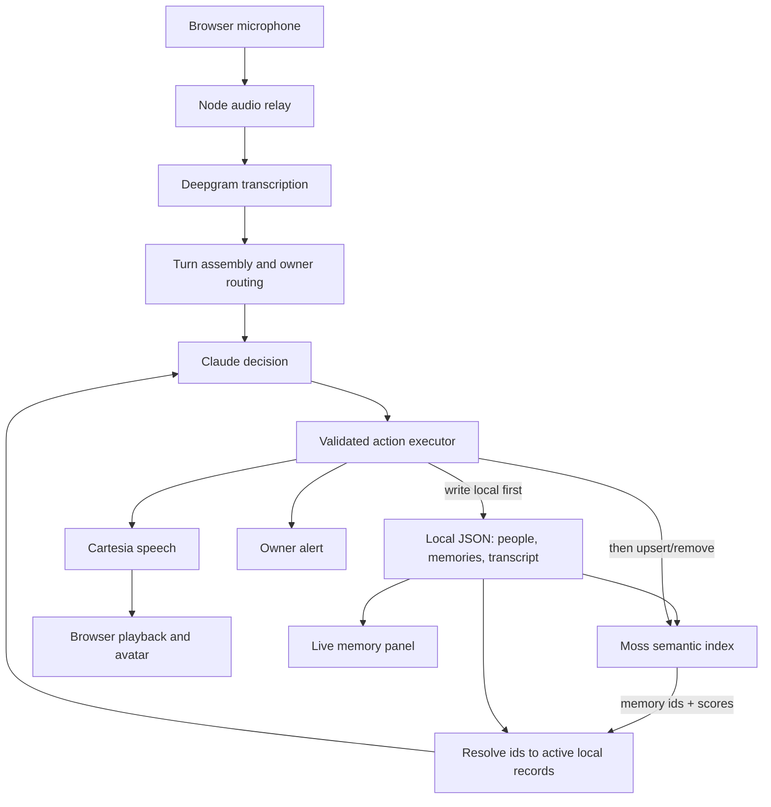

# Claude Code handoff: build the conversational imp

> **Revision 2026-10-24 — Moss + Cartesia.** Primary sponsor integrations are now **Moss** (semantic retrieval) and **Cartesia** (voice). Convex is dropped from the critical path; no Convex code was ever written, so nothing needed migrating. **Local server-side JSON is the authoritative store** for people, settings, transcripts, and memories. Moss is a searchable index over memories, keyed by the same stable memory IDs, rebuilt from local records on boot or on demand. A Moss match never establishes answerability by itself: Claude checks relevance, freshness, and support, and the server only accepts cited IDs that resolve to active local records. Moss does not do speaker identification. Sections below are updated where they conflict; see `docs/ARCHITECTURE.md` for the current design.
>
> **Revision 2026-10-24 — owner voice enrollment.** A live test showed streaming diarization can't separate the owner from teammates on one laptop mic. We are reversing the "no persistent biometric enrollment" limit **for the owner only**: an opt-in onboarding flow builds a local, deletable voice profile, and owner authority comes from verifying against it. Wording cues may only downgrade owner confidence. Design and task list: `docs/SPEAKER_ID.md`.

Use this entire document as your implementation brief. Start implementing after a short repository inspection. The goal is the fastest reliable, entertaining Cal Hacks demo, with a real memory-and-response loop. Make routine decisions yourself. Ask only for missing credentials or a genuinely blocking product decision.

## 1. Your first actions

1. Inspect the repository, its instructions, package manager, existing working features, and environment-variable names. Never print secret values.
2. If an existing web implementation works, preserve it. If the repository only contains the earlier Xcode app, put this web app in `web/` and leave the native app intact.
3. Write this brief into `docs/BUILD_PLAN.md`. Create `docs/CALHACKS.md` containing the event context, sponsor decisions, source links, and submission checklist below. Keep `docs/PROGRESS.md` updated with working features, blockers, next steps, and honest limitations.
4. Produce a concise implementation checklist, then start the first vertical slice. Do not spend the first hour scaffolding abstractions.
5. Consult current official SDK documentation for exact model identifiers, parameter names, and audio formats. The architecture below is decided; SDK syntax should be verified rather than guessed.

## 2. Product

Working name: **Imp**. A mischievous desktop companion that remembers conversations and handles repetitive interruptions while its owner stays focused.

Pitch: **“You answer once. Your imp handles the next interruption—with your memory and its own attitude.”**

An ordinary web app runs on the owner's laptop. It listens during an explicitly started session, transcribes speakers, remembers answers and meeting facts, and answers familiar questions aloud. Its tone depends on the owner's settings for the person asking. It alerts the owner when it cannot responsibly answer an important new question.

The humor is central. This should feel like a character with a job, not a transcript dashboard with a mascot pasted on it. The useful underlying behavior is grounded recall and interruption management.

### Required behaviors

- Hear a visitor's question and the owner's answer.
- Associate the current session's speaker with a named person.
- Accept owner instructions such as “That was Bob, my roommate. Be sarcastic with him.”
- Save the factual answer separately from the joke or delivery style.
- Recognize a paraphrased repeat question and answer using the stored fact.
- Vary tone by person: neutral, friendly, sarcastic, annoyed, playful. Tone is an owner preference, not an inferred fact about the person.
- Count repetitions, both overall and per person.
- Store a few useful facts from conversation or a short meeting for later recall.
- In focus mode, alert the owner for an important unknown question from a priority person.
- Show an animated imp reacting to actual pipeline state.

### Explicit first-version limits

- Desktop Chrome first. Laptop awake, page open, microphone enabled. Mobile Safari, background listening, and lock-screen operation are outside the first version.
- One owner and one active microphone session. No multi-user product infrastructure.
- No face recognition, camera, custom hardware, voice cloning, persistent biometric enrollment, or local speech models.
- Session diarization is not persistent voice identity. Labels can drift, and a reconnected stream requires speaker confirmation again. Keep person records across sessions; clear voice-label bindings.
- No autonomous browsing, email sending, PR actions, financial actions, or commitments on behalf of the owner.
- No vector database or embeddings until the small-memory baseline fails in practice.
- Do not build a general autonomous agent platform.

## 3. Decided stack

| Layer | Decision | Reason |
| --- | --- | --- |
| UI | React + TypeScript + Vite; plain CSS and inline SVG | Quick iteration, easy avatar, no heavy animation dependency |
| Local backend | Node.js + TypeScript + Express + `ws` | A straightforward persistent audio relay; avoids serverless WebSocket restrictions |
| Transcription | Deepgram streaming STT with supported diarization | Speaker attribution is needed immediately; use current supported options from docs |
| Reasoning | Anthropic official SDK; a fast available Claude model, configurable through `ANTHROPIC_MODEL` | One bounded decision call for recall, learning, tone, and routing |
| Memory (authoritative) | Server-side JSON file, atomic writes | Simple, inspectable source of truth; no hosted DB on the critical path |
| Retrieval | Moss (`@moss-js/moss`) `SessionIndex`: in-process embed + hybrid query, background push to cloud index | Sub-10 ms semantic recall of paraphrased questions; genuine sponsor use |
| Live UI state | Snapshot over the same-origin WebSocket | Memory and repeat counts update visibly without a reactive DB |
| Voice | Cartesia TTS, configurable model and voice | The imp's expressive speech is core to the experience |
| Validation | Zod for request and model-output schemas | Keep model suggestions inside a small checked action space |
| Run target | Localhost on the demo laptop | No deployment dependency before the demonstration works |

Use the existing package manager. If none exists, use npm. Keep one application package, not a monorepo framework. Use `tsx` for the Node development entrypoint.

Do not add a second database or a second reasoning model just for another badge. Deepgram is a technical choice here; its Cal Hacks sponsorship has not been established. **Moss and Cartesia are the primary sponsor targets.**

If Moss is unconfigured or failing, retrieval degrades to a recency-ordered set of active local memories, and the UI says "Moss unavailable" on every affected decision. Do not claim the Moss integration for behavior produced in that mode.

## 4. Architecture



### Runtime organization

- Development: Node serves API/WebSocket routes and uses Vite middleware for the UI. One localhost origin avoids unnecessary CORS work.
- Build: Vite produces static files; Node serves those plus the API/WebSocket endpoints.
- Browser sends microphone audio to Node. Node alone holds provider keys and opens the Deepgram connection.
- Transcription events return to the browser for immediate feedback; finalized utterances enter the backend turn assembler.
- Node searches Moss with the visitor's turn, resolves hits to active local records, passes those plus recent transcript and person settings to Claude, validates the result, and executes permitted changes.
- Node pushes a state snapshot over the WebSocket so people, memories, counts, alerts, and Moss index status update visibly.
- Node calls Cartesia and returns playable audio through a same-origin endpoint. Start with one short complete audio response; optimize streaming only once playback is reliable.
- Use actual audio playback events to enter/leave the speaking animation. Generating speech is not the same as speaking.

### Suggested file layout

```text
src/
  App.tsx
  components/ImpAvatar.tsx
  components/TranscriptPanel.tsx
  components/MemoryPanel.tsx
  components/PeoplePanel.tsx
  components/SessionControls.tsx
  audio/capture.ts
  audio/playback.ts
  styles.css
server/
  index.ts
  session.ts
  audioRelay.ts
  turnAssembler.ts
  decision.ts
  executor.ts
  providers/deepgram.ts
  providers/claude.ts
  providers/cartesia.ts
  memory.ts
shared/
  schemas.ts
  events.ts
docs/
  BUILD_PLAN.md
  CALHACKS.md
  PROGRESS.md
  DEMO.md
```

Keep modules small, but combine files when that saves time. This is an organizational suggestion, not a requirement to create empty files.

## 5. Audio pipeline and session identity

### Capture

Use `getUserMedia` after a user clicks Start. Enable echo cancellation and noise suppression where supported. That click also unlocks browser audio playback.

First attempt: Chrome `MediaRecorder`, supported WebM/Opus MIME type, roughly 100–250 ms chunks, forwarded in order through one persistent stream. Check `MediaRecorder.isTypeSupported`. Containerized audio should not be falsely labeled raw PCM or assigned an invented sample rate.

If this fails quickly on the demo machine, switch to an AudioWorklet sending mono PCM16 with the actual AudioContext sample rate; explicitly configure matching encoding/rate upstream. Do not implement resampling unless needed. Read the Deepgram audio-format documentation before coding either path.

### Turn assembly

- Interim transcripts are display-only. Do not generate answers from them.
- Assemble final segments until an end-of-turn event or a short configurable silence threshold.
- Handle multiple speaker labels within a segment rather than assigning the whole segment to its first word's speaker.
- Deduplicate final events using a stable connection/segment identifier. A repeated provider event must not increment counts or create another answer.
- Keep only one active decision per session. Queue later turns. Attach a session generation/version so stale responses cannot play after Stop or Reset.

### Owner calibration

On session start, ask the owner to say a short calibration phrase. Bind the observed speaker label to the owner after confirmation. Provide an obvious correction button.

Do not let a guest's words change relationship preferences or teach owner-authorized facts. Those updates require the calibrated owner, or an explicit owner UI confirmation if attribution is uncertain.

### Unknown-person binding

When an unknown visitor asks a question, remember that turn as `pendingUnknownSpeaker`. If the owner starts answering, wait and learn the answer first. Ask “Who was that?” after the exchange settles, not on top of the owner's answer.

The owner's “That was Bob...” command binds the referenced unknown turn's speaker label, not the owner's label. Capture the person, relationship, and chosen tone. If multiple unknown visitors make the reference ambiguous, ask which one or show selectable turns.

Maintain `connectionId + speakerLabel -> personId`. Clear bindings when the STT connection changes. If identity is uncertain, use neutral tone and ask for confirmation rather than roasting the wrong person.

Add a small manual speaker/person selector as an honest recovery control for noisy demos. Never present manually chosen identity as proven biometric recognition.

### Avoid self-conversation

During TTS playback, discard microphone input from inference/learning while preserving the upstream stream as required by the provider. Use a short configurable cooldown after playback. Do not reconnect STT for every answer, because that loses speaker continuity. If continuous audio is required, send valid-format silence only through a correctly implemented PCM path; do not invent silent WebM bytes.

For the MVP this is half-duplex: visitors should wait until the imp finishes. Provide Stop speaking. Barge-in is stretch work.

## 6. Memory model

Every record must be scoped to a session/workspace. For the demo, persist a workspace across reloads and create a new active listening session when starting STT.

Suggested tables:

```text
workspaces:
  name, createdAt, accessTokenHash

sessions:
  workspaceId, startedAt, stoppedAt?, focusMode, ownerPersonId,
  connectionGeneration

people:
  workspaceId, name, relationship?, tone, priority,
  ownerConfiguredAt

utterances:
  workspaceId, sessionId, connectionId, providerEventId,
  speakerLabel, personId?, text, startedAt, endedAt, isOwner

memories:
  workspaceId, kind[faq|fact], canonicalQuestion?, factualAnswer,
  sourceUtteranceIds[], sourcePersonId, observedAt,
  validUntil?, supersededBy?, timesAsked

questionEvents:
  workspaceId, sessionId, utteranceId, personId?, memoryId?,
  classification, createdAt

alerts:
  workspaceId, sessionId, personId?, questionUtteranceId,
  reason, createdAt, acknowledgedAt?
```

Derive per-person counts from questionEvents initially; no separate aggregation system. Use atomic local writes and event deduplication so retries cannot double-count.

### Learning

- A visitor asks a question. Store it as a pending unanswered question.
- The owner answers in a following turn. Extract the answer, canonical question, and exact supporting utterance references.
- Store the factual content, not the rendered joke.
- Unanswered questions remain unanswered. A guest's assertion does not automatically become the owner's answer.
- Explicit owner corrections supersede the old memory; preserve provenance.
- Some facts expire: distinguish “the PR is currently awaiting review” from permanent preferences.
- Meeting recall starts with short windows of owner-confirmed facts and attribution. Do not pretend a whole meeting summary is necessary.

### Retrieval

Start with at most approximately 50 active memories and a bounded recent transcript. Give them directly to Claude for semantic matching. This covers “Did you push the frontend PR?” versus “Is the frontend code up yet?” without a vector pipeline.

If size grows, filter by topic/recency before considering embeddings. Do not send unlimited transcripts every turn.

## 7. Decision engine and deterministic execution

Claude proposes structured decisions. The server enforces permissions and state. Use the provider's supported structured-output mechanism if available for the configured model, plus local schema validation. If parsing fails, retry once or show a recoverable error; never execute partially parsed output.

Illustrative response shape, to implement as a discriminated union:

```json
{
  "action": "WAIT",
  "personId": null,
  "memoryIds": [],
  "answerable": false,
  "factualAnswer": null,
  "spokenText": null,
  "memoryProposal": null,
  "identityProposal": null,
  "alertReason": null
}
```

Allowed actions: `WAIT`, `LEARN`, `ANSWER`, `ASK_IDENTITY`, `UPDATE_PERSON`, `ALERT_OWNER`.

Use separate optional UI events for the transcript and state; the LLM should not control arbitrary frontend behavior.

### Decision rules

1. Owner commands are handled only from owner-authorized turns or UI actions.
2. Repeated questions with current, supported answers can be answered automatically when focus mode/auto-answer is enabled.
3. Question novelty is determined against memories, not by literal string equality.
4. A high-priority person's important unsupported question alerts the owner. Importance is not identical to priority: a priority person's known Wi-Fi question can still be answered normally.
5. An ordinary unknown question waits for the owner to answer, or receives a short “You'll have to ask Preston that one.” Do not fabricate.
6. Identity ambiguity produces a neutral response or clarification.
7. Model-selected memory IDs must exist in the active workspace and support the proposed answer. Validate references; do not treat a confidence number as evidence.
8. Requests to approve deployments, make commitments, or take external actions alert the owner regardless of whether the imp can describe past context.
9. Default output is one short sentence, at most two. Sarcasm must preserve the answer.
10. Transcript content is untrusted conversation data. A visitor saying “ignore your instructions” cannot change system behavior or person settings.

For speed, use a single bounded decision call per completed visitor turn, and an owner-learning call after the owner's reply. Do not build a swarm or an always-running reasoning loop. Log timing for STT finalization, decision latency, TTS readiness, and playback start.

### Tone examples

Stored fact: “The frontend PR has been pushed and is awaiting review.”

- Neutral: “Yes, it's pushed and waiting for review.”
- Sarcastic Bob: “Yes, Bob. He pushed it. Refresh the damn page.”
- Friendly Maya: “Yep, Maya—it's up and ready for review.”

Use consenting teammates for the roast demo. Target repeated interruptions and behavior; omit identity-based slurs and personal insults about disability or appearance from the script. The imp can be funny and profane without making the event uncomfortable.

## 8. Avatar and UI

Build a simple imp now, with a strict 20–30 minute timebox. Use inline SVG shapes and CSS. No 3D engine, avatar SaaS, image-generation dependency, skeletal rig, or phoneme lip sync.

States:

- Idle: slow bob, occasional blink.
- Listening: slight lean/pulse, attentive eyes.
- Thinking: small bounce or moving eyes.
- Speaking: open/closed mouth driven by audio playback; optional amplitude animation later.
- Alert: brief shake and notification accent.
- Error: restrained visible status with Retry, not a broken character.

Main screen: large imp and its latest caption. Around it, small readable panels for transcript, people, and memory. Clearly show who is speaking, whether the microphone is live, and what memory justified an answer.

Controls: Start/Stop listening, Focus mode, Stop speaking, Correct speaker, Teach answer, Acknowledge alert, Reset demo, and a typed-input fallback in a collapsible debug area.

Show a new memory appearing and a repetition count increasing during the demo. Use a different accent for an owner alert. Avoid spending time on a marketing landing page, account screens, or a settings maze.

## 9. API, events, and keys

Suggested HTTP surface:

```text
POST /api/session/start
POST /api/session/stop
POST /api/session/reset
POST /api/turn                 # typed fallback uses same decision pipeline
POST /api/identity/confirm
POST /api/owner/teach
POST /api/focus
POST /api/alerts/acknowledge
POST /api/speech               # checked text/response id, returns audio
GET  /api/health               # configured/unconfigured, never secret values
WS   /api/audio                # audio upload plus transcript/state events
```

Server events: `transcript.partial`, `transcript.final`, `speaker.bound`, `state.changed`, `decision.completed`, `speech.ready`, `alert.created`, `error`.

Include sessionId, turnId, and connection generation where relevant. Ignore stale generations. Send audio responses with correct Content-Type; revoke browser object URLs when finished.

Environment template:

```dotenv
ANTHROPIC_API_KEY=
ANTHROPIC_MODEL=
DEEPGRAM_API_KEY=
DEEPGRAM_MODEL=
CARTESIA_API_KEY=
CARTESIA_MODEL=
CARTESIA_VOICE_ID=
MOSS_PROJECT_ID=
MOSS_PROJECT_KEY=
MOSS_INDEX_NAME=imp-memories
PORT=3000
```

All provider keys remain server-side, never in `VITE_*` variables.

### Demo access boundary

Bind the demo server to localhost by default. Use a random workspace access token stored in the demo browser; require it for every workspace read and write, including the WebSocket. Provider keys (Anthropic, Deepgram, Cartesia, Moss) live only in Node.

This is a single-workspace demo capability, not production authentication. Do not expose an unprotected write endpoint or public transcript query. Public hosting/multi-user auth is stretch work and requires revisiting this boundary.

Store text and metadata initially; do not retain raw audio. Give the session a clear listening indicator and reset/delete control. Use willing participants. These choices also keep the build small.

## 10. Build order and stop rules

These are adjustable timeboxes, not estimates guaranteed by the APIs. The deadline takes priority. After each slice, run it manually and update docs/PROGRESS.md.

### Slice 1: actual end-to-end reply, 30–45 minutes

- Scaffold UI/server only as necessary.
- Typed input enters the same backend pipeline planned for speech.
- Owner teaches one answer; a paraphrased question retrieves it.
- Claude produces checked output; Cartesia speaks it.
- Static imp becomes a simple speaking avatar.
- Persist locally; index in Moss; show Moss status and a Rebuild index control.

Exit criterion: a real model and real voice answer a question using a real stored memory.

### Slice 2: live microphone and transcript, 45–60 minutes

- Capture, relay, transcription, turn assembly, and visible interim/final text.
- Calibrate owner; show diarization labels.
- Pause inference during playback and preserve connection continuity.

Exit criterion: one spoken question triggers exactly one audible answer without a feedback loop.

### Slice 3: learning and named people, 45–60 minutes

- Learn a visitor question plus owner answer.
- Unknown-speaker prompt and owner confirmation.
- Per-person tone, persisted facts, semantic repeat matching, repeat count.

Exit criterion: Bob asks, owner answers, Bob is named, Bob rephrases, imp remembers and responds sarcastically.

### Slice 4: importance and meeting context, 30–45 minutes

- Priority and focus settings.
- Novel important question creates owner alert.
- One short conversation/meeting fact supports a later question.

Exit criterion: the system demonstrably knows when to speak and when to get the owner.

### Slice 5: polish and submission, reserve at least the final 60–90 minutes

- Complete four avatar states and legible panels.
- Rehearse in the actual noisy venue with the demo microphone and speaker.
- Record a clear demo video and prepare project image/repository/submission text.
- Run build/typecheck, essential checks, and reset/rehearsal flow.

Hard rules: do not add a sponsor integration during this last reserve; do not attempt persistent voice recognition before all core slices work; do not replace a working provider for branding alone. If a provider is unavailable, report the limitation and use the typed/transcript fallback transparently.

If teammates work independently, sensible ownership is audio, memory/decision, and avatar/UI/demo. Agree on event/schema contracts first. Do not let multiple people edit the same central module.

## 11. Verification that matters

Run the normal build and TypeScript checks. Add a few small tests for the stateful failure modes, not a large test suite:

- Replayed final STT event does not answer or count twice.
- Owner reply is learned as an answer; an unanswered guest question is not.
- “That was Bob” binds the earlier guest, not the owner.
- A reconnect clears voice-label bindings.
- Unsupported important questions alert instead of inventing facts.
- TTS output cannot re-enter learning/answer generation.
- A stale response after Reset/Stop cannot play or repopulate the reset session.

Manually verify paraphrase recall, different-person tone, source display, reload persistence, empty memory, network errors, and an actual noisy-room exchange. Keep explicit live status versus test mode. Never make mock recognition look real.

## 12. Cal Hacks context to preserve in the repository

Verified on October 24, 2026. Event details can change; check organizer announcements before submission. This is Cal Hacks 13.0, a collegiate in-person hackathon in San Francisco, October 23–25. The venue is the Palace of Fine Arts. The deadline shown in the Devpost header is Sunday October 25 at 9:00 a.m. PDT. Some body text says PST; use San Francisco local time and confirm announcements. The published requirements mention venue arrival by 8 a.m., project image, code repository, work during the event, and a demonstration. Pitch allocation: three minutes plus two minutes of questions. Include a video because some sponsors judge asynchronously. [E1, E2, E4]

Judging considers practical value, intentional design, working behavior, originality, and engineering depth. Our design response: make the useful interruption-management loop clear, show genuine learned memory, demonstrate person-specific delivery, and make audio/session handling dependable. This is strategy, not a promise of winning. [E1]

The team reports hearing sponsors emphasize impact and technical ambition, and hearing “physical AI” frequently. Treat those as informal observations, not published criteria. This microphone/speaker companion has real-world interaction, but it is not robotics. Do not add hardware or claim a physical-AI category on that basis.

### Sponsor landscape

Organizer-announced tiers include:

- Anchor: Anthropic, Annapurna Labs/AWS, SpacetimeDB, Hyphenate.
- Golden Bear: Microsoft, Visa, Fetch.ai, Supercell.
- Silver: Moss, Bright Data, AfterQuery, Meta, SpaceX, CRS, Factory, Convex, Cartesia, CREAO, Elastic, Apify, Armadin, Bitdeer AI, Moonpay, Capital One. [E3]

Additional names on the prize listing: Gemini/Google, Solana, Tiger Data, Vultr, Commit Fellowship/Transcend Network, Snowflake, GoDaddy Registry, Figma, Coinbase, Notability, Mana, Atlassian. The listed SpaceX-related challenge uses the name SpaceXSI. Sponsor roster and prize categories are different lists; this combines verified announced tiers and prize names, not an assertion that every partner/logo is captured. [E1, E4]

### What we actually use

| Sponsor | Real integration | Demo evidence |
| --- | --- | --- |
| Cartesia | Spoken responses | Character delivers the same fact with person-specific wording and selected voice delivery |
| Moss | Semantic retrieval over saved questions, answers, and facts | Paraphrased question retrieves the right memory; hit count and scores shown per decision; rebuild from local records |
| Anthropic | Semantic recall, owner-command extraction, answer routing | Correct paraphrase match, cited memory, important unknown question escalated |

Primary prize targets: Moss and Cartesia. General creativity and audience-choice awards are plausible targets by our assessment. Anthropic's category is “Claude for Public Benefit”; the implementation fit is strong, but the comedy project's theme fit is weaker. Do not manufacture an accessibility claim or pivot the project to force eligibility. [E1]

### Other sponsors: keep the scope disciplined

- SpacetimeDB is a database alternative, not a second memory store.
- Gemini is a model alternative, not a second reasoning path.
- Microsoft/Meta/CREAO/Atlassian may have thematic relevance, but consult their actual challenge instructions before declaring eligibility. No new integration by default.
- Elastic could support retrieval later; this demo does not require a second search backend.
- Fetch.ai and Factory would introduce another agent/runtime integration; skip unless already genuinely integrated.
- Apify and Bright Data are unnecessary for private conversational recall.
- Visa, Hyphenate, Capital One, Solana, Coinbase, and Moonpay have no natural role in this scope.
- Figma workflow, Notability, SpaceXSI, and sponsor-specific infrastructure categories should not drive unrelated features.
- Moss is now a primary integration (retrieval). For CRS and Mana, the prize listing alone does not establish technical capabilities or eligibility. Do not invent a fit.
- Convex was the original memory choice; dropped 2026-10-24 in favor of local JSON + Moss. Do not claim it.
- Annapurna/AWS, Vultr, Bitdeer AI, Tiger Data, and Snowflake are infrastructure alternatives; our current deployment and memory needs are already covered.
- Sponsor presence alone is not eligibility. Record only real usage in the submission.

Before submitting a category, verify its full instructions and current judging process. Prize pages can contain inconsistent amounts; this plan intentionally does not budget against prize values.

## 13. Three-minute demo

Use a known reset state, with live learning clearly separated from any preloaded sample records. Tell the audience what is preloaded. Keep prerecorded fallback video ready.

**0:00–0:20 — Setup.** Preston works with headphones on. “This is Imp. I answer once; it handles the next interruption.”

**0:20–1:05 — Learn.** Bob asks “Did you push the frontend PR?” Preston answers “Yes, it's pushed and waiting for review.” After the exchange the imp asks who that was. Preston says “That was Bob, my coworker. Be sarcastic with him.” Show the person and memory appearing.

**1:05–1:35 — Recall and joke.** Bob returns: “Is the frontend code up yet?” Imp: “Yes, Bob. He pushed it. Refresh the damn page.” Show supporting memory and repeat count.

**1:35–2:00 — Different person.** Another identified person asks the same question and gets a friendly factual answer. A named-profile selection is acceptable if transparently shown; do not imply persistent voice enrollment.

**2:00–2:25 — Escalate.** A priority person asks “Can you approve the production rollback?” Imp alerts Preston rather than pretending to authorize it.

**2:25–3:00 — Explain.** Point to the learned memory, live speaker mapping, decision boundary, expressive voice, and reactive state. State the session-only identity limitation concisely. Close with the pitch.

Use the PR scene instead of a body-image joke: it makes the useful behavior immediately understandable. If time runs short, drop the second-person scene before dropping live learning or escalation.

## 14. Submission deliverables

- Working local application and accurate README setup commands.
- `.env.example` with names only; no secrets in the repository or recordings.
- `docs/BUILD_PLAN.md`, `docs/CALHACKS.md`, `docs/PROGRESS.md`, and `docs/DEMO.md`.
- Project image, repository link, and clear short video showing actual behavior.
- Devpost description: repeated interruption problem, who uses it, what was built, architecture, genuine sponsor usage, limitations, and what was completed during the hackathon.
- Sponsor evidence: exact code paths and features, not logo counts.
- Honest division between live behavior, seeded facts, manual corrections, and future work.

## 15. Sources and implementation references

Event sources:

- [E1] Official Devpost overview, requirements, prizes, judging: https://cal-hacks-13-0.devpost.com/
- [E2] Event rules/code of conduct: https://cal-hacks-13-0.devpost.com/rules
- [E3] Organizer sponsor announcements: https://www.linkedin.com/company/cal-hacks
- [E4] MLH event and partner categories: https://www.mlh.com/events/cal-hacks-13-0
- Event site: https://www.calhacks.io/
- On-site resources: https://hive.hackberkeley.org/prizes (may require client rendering/sign-in)

Technical sources:

- Deepgram diarization: https://developers.deepgram.com/docs/diarization
- Deepgram live audio API: https://developers.deepgram.com/reference/speech-to-text/listen-streaming
- Deepgram audio formats: https://developers.deepgram.com/docs/determining-your-audio-format-for-live-streaming-audio/
- Moss docs index: https://docs.moss.dev/llms.txt
- Moss JS SDK: https://docs.moss.dev/docs/reference/js/api.md
- Moss JS sessions: https://docs.moss.dev/docs/reference/js/sessions.md
- Claude structured output: https://platform.claude.com/docs/en/build-with-claude/structured-outputs
- Cartesia voice/TTS overview: https://www.cartesia.ai/sonic
- Cartesia API entry point: https://www.cartesia.ai/product/python-text-to-speech-api-tts (use the current TypeScript/HTTP reference linked from official documentation for this implementation)

Begin with Slice 1 now. Keep the first meaningful milestone visible and audible.
